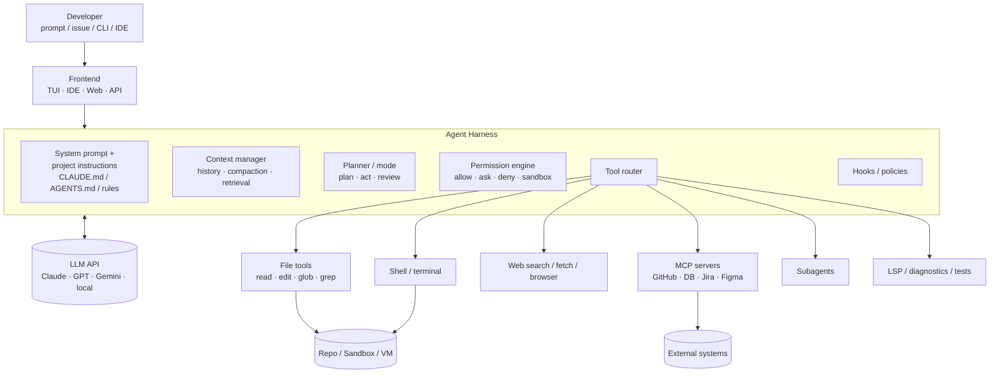
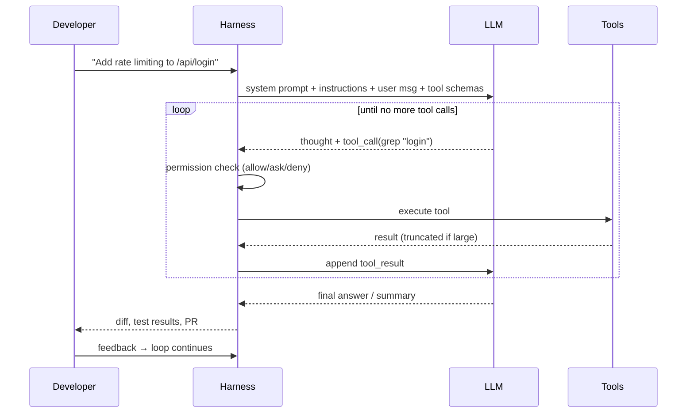
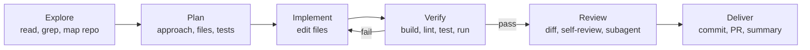
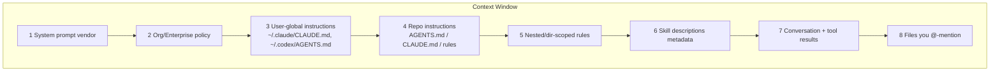
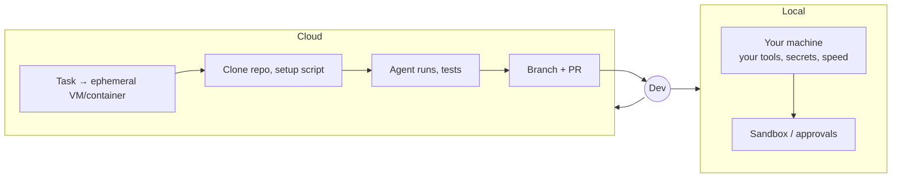
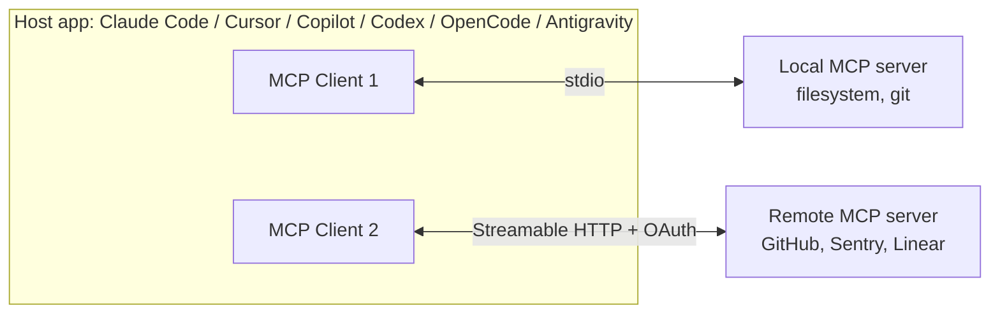
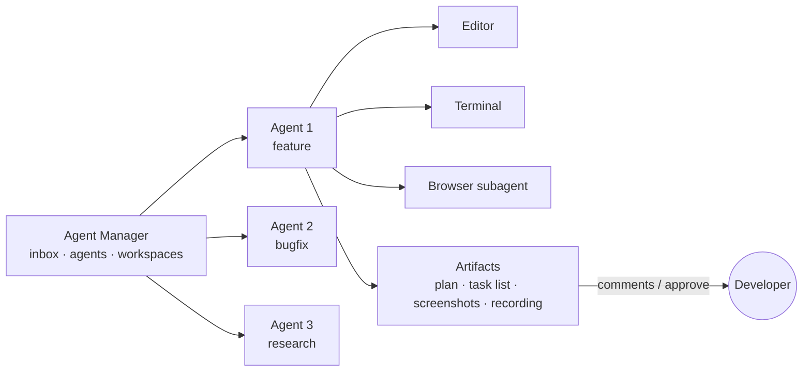
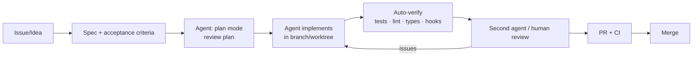
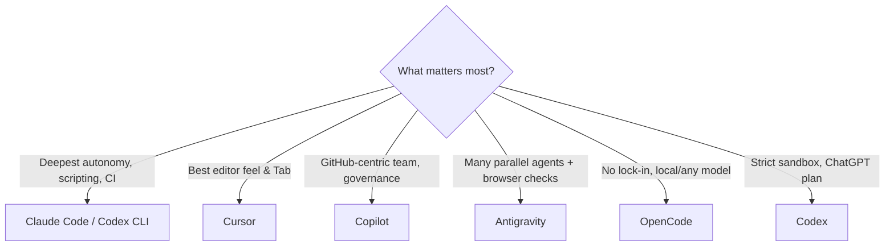

# AI Coding Agents – Reference Card & Cheat Sheet

**Covers:** Claude Code · GitHub Copilot · OpenAI Codex · Cursor · Google Antigravity · OpenCode
**Version of this sheet:** November 2026 (knowledge-based; this field moves weekly, so verify flags, model names and prices against the official docs before relying on them)

---

## Table of Contents

1. [Basics: What is an AI coding agent?](#1-basics-what-is-an-ai-coding-agent)
2. [Core concepts & glossary](#2-core-concepts--glossary)
3. [Architecture & agent loop (with diagrams)](#3-architecture--agent-loop)
4. [Protocols: MCP, ACP, A2A, AGENTS.md, LSP](#4-protocols)
5. [Tools an agent uses](#5-tools-an-agent-uses)
6. [Formats & config files (cross-tool matrix)](#6-formats--config-files)
7. [Tool-by-tool reference cards](#7-tool-by-tool-reference-cards)
8. [Command cheat sheets](#8-command-cheat-sheets)
9. [Code snippets & templates](#9-code-snippets--templates)
10. [Typical use cases & workflows](#10-typical-use-cases--workflows)
11. [Pros & cons, comparison matrix](#11-pros--cons--comparison)
12. [Security & safety](#12-security--safety)
13. [Best practices & anti-patterns](#13-best-practices--anti-patterns)
14. [Troubleshooting & quick decision guide](#14-troubleshooting--decision-guide)

---

## 1. Basics: What is an AI coding agent?

An **AI coding agent** is an LLM wrapped in a **loop** with **tools** (read/write files, run shell commands, search, browse, call APIs) and **context management**, so it can pursue a goal over many steps rather than answering one prompt.

| Generation | Interaction | Example |
|---|---|---|
| 1. Autocomplete | Inline ghost-text suggestions | Early Copilot, Tab completion |
| 2. Chat assistant | Q&A about code, copy/paste | ChatGPT, Copilot Chat |
| 3. Editor agent | Multi-file edits with diffs, runs commands with approval | Cursor Agent, Copilot Agent mode |
| 4. Autonomous / async agent | Works in background/cloud/sandbox, opens PRs | Copilot coding agent, Codex cloud, Cursor background agents, Claude Code on the web |
| 5. Multi-agent orchestration | Several agents in parallel, manager view, subagents | Antigravity Manager, Claude Code subagents, Cursor parallel agents |

**Form factors**

| Form | Examples | Strength |
|---|---|---|
| Terminal CLI/TUI | Claude Code, Codex CLI, OpenCode, Copilot CLI, Cursor CLI | Scriptable, CI-friendly, editor-agnostic |
| IDE (VS Code fork) | Cursor, Antigravity | Visual diffs, inline UX |
| IDE extension | Copilot, Codex IDE ext, Claude Code ext | Fits existing setup |
| Cloud/async | Copilot coding agent, Codex cloud, Claude Code web | Parallel, fire-and-forget, PR output |
| SDK/headless | Claude Agent SDK, Codex SDK/exec, OpenCode server | Build your own agents/automation |

---

## 2. Core concepts & glossary

| Term | Meaning |
|---|---|
| **Agent loop** | Repeat: observe → think → call tool → observe result … until done |
| **Context window** | Max tokens the model sees (prompt + history + tool results). Fills quickly; the #1 quality factor |
| **Context engineering** | Deciding what goes into context (instructions, files, search results, summaries) |
| **Compaction** | Summarizing old history to free context (`/compact`) |
| **Tool call / function calling** | Model emits structured JSON request; harness executes and returns result |
| **Harness / scaffold** | Everything around the model: loop, tools, permissions, prompts. Often matters as much as the model |
| **System prompt** | Hidden base instructions from the vendor |
| **Project instructions / memory** | Persistent markdown (`CLAUDE.md`, `AGENTS.md`, rules) loaded each session |
| **Rules** | Scoped instructions (global, per-directory, per-glob, per-agent-requested) |
| **Skills** | Folders with `SKILL.md` + scripts/resources, loaded on demand (progressive disclosure) |
| **Subagent** | Specialized child agent with own context & tool set; returns a summary to parent |
| **Hooks** | Deterministic scripts triggered on lifecycle events (pre/post tool use, stop, prompt submit) |
| **Slash command / prompt file** | Reusable saved prompt template (`/review`, `.prompt.md`) |
| **MCP** | Model Context Protocol – open standard to plug tools/data into agents |
| **Plan mode** | Read-only exploration + plan approval before edits |
| **Permission mode / approval policy** | What the agent may do without asking (read-only / edit / full auto) |
| **Sandbox** | OS-level isolation (filesystem/network limits) for executed commands |
| **Checkpoint / rewind** | Snapshot of code/conversation state to undo agent changes |
| **Worktree** | Separate git working dir per agent → safe parallel work |
| **Headless / non-interactive mode** | Run agent from scripts/CI with a single prompt |
| **Background / cloud agent** | Agent running remotely in a VM/container, delivers branch/PR |
| **Artifacts** (Antigravity) | Verifiable deliverables: task lists, plans, screenshots, recordings |
| **Spec-driven development** | Write spec → agent plans → tasks → implements (Spec Kit, Kiro style) |
| **Vibe coding** | Prompt-driven building with minimal code review (risky for production) |
| **Reasoning / thinking budget** | Extended thinking tokens for harder problems (`think`, effort levels) |
| **Evals** | Tests measuring agent quality (SWE-bench, Terminal-Bench, your own repo tasks) |

---

## 3. Architecture & agent loop

### 3.1 Generic architecture



### 3.2 The agent loop (ReAct style)



### 3.3 Typical task lifecycle



### 3.4 Context layering



**Key insight:** Instructions (layers 1–6) are cheap & stable; tool outputs (7) grow and cause "context rot". Use subagents, compaction and `/clear` between unrelated tasks.

### 3.5 Local vs. cloud execution



### 3.6 Multi-agent patterns

| Pattern | Description | Used by |
|---|---|---|
| Orchestrator–workers | Parent delegates to specialist subagents | Claude Code subagents, Antigravity Manager |
| Parallel worktrees | N agents, N branches, pick best | Cursor, Claude Code (`git worktree`), Codex cloud |
| Writer / reviewer | One implements, another reviews fresh context | Any (subagent or second session) |
| Pipeline | Plan agent → code agent → test agent | Custom via SDK |
| Best-of-N | Same prompt to several models, compare | Cursor multi-model, Copilot model picker |

---

## 4. Protocols

### 4.1 MCP – Model Context Protocol (the key standard)

Open protocol (originated by Anthropic, 2024; now broadly adopted, governed under the Linux Foundation's Agentic AI Foundation) based on **JSON-RPC 2.0**.



| MCP primitive | Controlled by | Purpose |
|---|---|---|
| **Tools** | Model | Actions (`create_issue`, `query_db`) |
| **Resources** | App/user | Read-only data (files, schemas, docs) addressed by URI |
| **Prompts** | User | Reusable templated prompts (often surfaced as slash commands) |
| **Sampling** | Server → client | Server asks host LLM for completion |
| **Elicitation** | Server → user | Server asks the user for input |
| **Roots** | Client | Tells server which directories it may operate in |

**Transports:** `stdio` (local subprocess), **Streamable HTTP** (remote; supersedes older HTTP+SSE), auth via **OAuth 2.1**.

**Minimal JSON-RPC exchange**
```json
// client → server
{"jsonrpc":"2.0","id":1,"method":"tools/list"}
// server → client
{"jsonrpc":"2.0","id":1,"result":{"tools":[{
  "name":"get_weather",
  "description":"Get weather by city",
  "inputSchema":{"type":"object","properties":{"city":{"type":"string"}},"required":["city"]}
}]}}
// call
{"jsonrpc":"2.0","id":2,"method":"tools/call","params":{"name":"get_weather","arguments":{"city":"Frankfurt"}}}
```

### 4.2 Other protocols & conventions

| Protocol / convention | Purpose | Notes |
|---|---|---|
| **AGENTS.md** | Vendor-neutral repo instruction file | Read by Codex, Copilot, Cursor, OpenCode, Antigravity, others; Claude Code uses `CLAUDE.md` (can import `@AGENTS.md`) |
| **Agent Skills (`SKILL.md`)** | Packaged, on-demand capabilities | Introduced by Anthropic, open format; now adopted in several tools (verify per tool) |
| **ACP – Agent Client Protocol** | Editor ↔ agent protocol (Zed and others), "LSP for agents" | Lets any editor host any agent (JSON-RPC over stdio) |
| **A2A – Agent2Agent** | Agent ↔ agent interoperability (Google, now Linux Foundation) | Agent Cards, tasks, over HTTP |
| **LSP – Language Server Protocol** | Diagnostics, go-to-definition, rename for agents | OpenCode and Claude Code (plugins) can use LSP feedback |
| **OpenAI-compatible API** | `/v1/chat/completions`, `/v1/responses` | Lets tools target local/other models (Ollama, vLLM, LiteLLM, OpenRouter) |
| **OpenTelemetry** | Observability of agent runs | Claude Code & Codex can export OTel metrics/logs |
| **OAuth / device flow** | Login to provider accounts | ChatGPT/Claude/GitHub/Google sign-in for CLIs |

### 4.3 Where MCP servers are configured

| Tool | Config location |
|---|---|
| Claude Code | `.mcp.json` (project, shareable), `~/.claude.json` (user/local), `claude mcp add …` |
| Cursor | `.cursor/mcp.json` / `~/.cursor/mcp.json` |
| Copilot (VS Code) | `.vscode/mcp.json` (`servers` key), org policy; coding agent: repo settings JSON |
| Codex | `~/.codex/config.toml` → `[mcp_servers.<name>]`, `codex mcp add` |
| OpenCode | `opencode.json` → `"mcp": {…}` |
| Antigravity | MCP servers via settings / MCP store (Agent panel → manage MCP) |

---

## 5. Tools an agent uses

| Category | Typical tool names | Purpose | Risk |
|---|---|---|---|
| **Read** | `Read`, `view`, `cat` | Open files, images, PDFs, notebooks | Low |
| **Search** | `Glob`, `Grep`/ripgrep, semantic/codebase search | Locate code | Low |
| **Edit** | `Edit`/`str_replace`, `Write`, `apply_patch`, `MultiEdit` | Modify files | Medium |
| **Shell** | `Bash`, terminal, `shell` | Build, test, git, scripts | **High** |
| **Web** | `WebSearch`, `WebFetch`, browser agent | Docs, APIs, UI testing | Medium (prompt injection) |
| **Task mgmt** | `TodoWrite`, plan/task list | Track multi-step work | Low |
| **Delegation** | `Task`/subagent tool | Spawn specialized agent | Low–Medium |
| **Notebook** | `NotebookEdit` | Jupyter | Medium |
| **MCP tools** | `mcp__server__tool` | External integrations | Varies |
| **Git/PR** | `gh`, GitHub MCP | Branches, PRs, issues | Medium |
| **Diagnostics** | LSP, linters, test runners | Verification feedback | Low |
| **Browser/computer use** | Antigravity browser subagent, Claude in Chrome, Playwright MCP | UI verification, scraping | Medium–High |

**Tool-call anatomy (generic):**
```json
{
  "type": "tool_use",
  "name": "Edit",
  "input": {
    "file_path": "/repo/src/auth.ts",
    "old_string": "const limit = 0;",
    "new_string": "const limit = 5;"
  }
}
```

**Edit strategies:** exact string replace (Claude), unified-diff/`apply_patch` (Codex), whole-file rewrite (small files), fast-apply model (Cursor's "apply" model). Exact-match edits fail if file changed → agent re-reads.

---

## 6. Formats & config files

### 6.1 Cross-tool matrix

| Purpose | Claude Code | Copilot | Codex | Cursor | Antigravity | OpenCode |
|---|---|---|---|---|---|---|
| Project instructions | `CLAUDE.md` | `.github/copilot-instructions.md`, `AGENTS.md` | `AGENTS.md` | `AGENTS.md`, `.cursor/rules/*.mdc` | `AGENTS.md`, rules (`.agent/rules/`) | `AGENTS.md` |
| User-global instructions | `~/.claude/CLAUDE.md` | VS Code user instructions | `~/.codex/AGENTS.md` | Settings → Rules (User) | `~/.gemini/GEMINI.md` (global rules) | `~/.config/opencode/AGENTS.md` |
| Scoped rules | `.claude/rules/`, nested `CLAUDE.md` | `.github/instructions/*.instructions.md` (`applyTo` glob) | nested `AGENTS.md` | `.mdc` with `globs`/`alwaysApply` | workspace rules, workflows | nested `AGENTS.md`, `instructions` in config |
| Saved prompts/commands | `.claude/commands/*.md`, skills | `.github/prompts/*.prompt.md` | `~/.codex/prompts/*.md`, skills | `.cursor/commands/*.md` | workflows (`.agent/workflows/`) | `.opencode/command/*.md` |
| Custom agents | `.claude/agents/*.md` | `.github/agents/*.agent.md` (custom agents) | profiles in `config.toml` | modes / custom agents | agents via Manager | `.opencode/agent/*.md`, `opencode.json` |
| Skills | `.claude/skills/<n>/SKILL.md` | supported in newer versions (verify) | `~/.codex/skills/` (verify) | partial (verify) | skills (verify) | via plugins/compat (verify) |
| Main settings | `.claude/settings.json`, `settings.local.json` | VS Code `settings.json` | `~/.codex/config.toml` | Settings UI / `.cursor/` | IDE settings | `opencode.json` / `.jsonc` |
| Ignore file | permissions deny rules | content exclusion (org) | sandbox/approval | `.cursorignore`, `.cursorindexingignore` | `.gitignore`-based | `.gitignore` + permissions |
| MCP | `.mcp.json` | `.vscode/mcp.json` | `config.toml` | `.cursor/mcp.json` | MCP settings | `opencode.json` |
| Hooks | `settings.json` `hooks` | limited (agent hooks, verify) | notify / hooks (verify) | hooks (`.cursor/hooks.json`, verify) | – | plugins (JS/TS) |

> ⚠️ Cells marked "verify" reflect fast-moving features. Check the tool's changelog.

### 6.2 Formats in detail

| Format | Structure |
|---|---|
| **Markdown + YAML frontmatter** | Skills, subagents, commands, `.mdc`, `.instructions.md`, `.prompt.md`, `.agent.md` |
| **JSON / JSONC** | `settings.json`, `.mcp.json`, `opencode.json`, `hooks.json` |
| **TOML** | Codex `config.toml` |
| **Unified diff / patch** | Edits & PRs (`apply_patch` envelope for Codex) |
| **JSONL transcripts** | Session logs (`~/.claude/projects/…`, `~/.codex/sessions/…`) |
| **stream-json / JSON output** | Headless machine-readable output |

### 6.3 `SKILL.md` format

```markdown
---
name: pdf-extractor
description: Extract text and tables from PDF files. Use when the user mentions PDFs, forms, or document extraction.
---

# PDF Extractor
## When to use
- User uploads or references a .pdf
## Steps
1. Run `python scripts/extract.py <file>`
2. If scanned, run OCR: `scripts/ocr.sh <file>`
## References
See [FORMS.md](FORMS.md) for form filling.
```
Folder layout:
```
.claude/skills/pdf-extractor/
├── SKILL.md          # metadata always loaded; body loaded when relevant
├── FORMS.md          # loaded on demand
└── scripts/extract.py
```
**Progressive disclosure:** name+description (~100 tokens) always in context → body when triggered → linked files/scripts only when needed.

### 6.4 Subagent file (Claude Code)

```markdown
---
name: code-reviewer
description: Expert code reviewer. Use proactively after code changes.
tools: Read, Grep, Glob, Bash
model: sonnet
---
You are a senior reviewer. Check: correctness, security, tests, naming.
Return findings grouped by severity (blocker / major / nit) with file:line.
```

### 6.5 Cursor rule (`.mdc`)

```markdown
---
description: React component conventions
globs: ["src/components/**/*.tsx"]
alwaysApply: false
---
- Use function components + hooks; no classes.
- Props typed with `interface XProps`.
- Co-locate tests as `*.test.tsx`.
```

### 6.6 Copilot instruction files

```markdown
<!-- .github/instructions/python.instructions.md -->
---
applyTo: "**/*.py"
---
Use type hints, ruff formatting, pytest for tests.
```
```markdown
<!-- .github/prompts/add-endpoint.prompt.md -->
---
mode: agent
description: Scaffold a REST endpoint
---
Create endpoint ${input:name} following patterns in #file:src/api/users.ts and add tests.
```

---

## 7. Tool-by-tool reference cards

### 7.1 Claude Code (Anthropic)

| Aspect | Details |
|---|---|
| **Type** | Terminal-first agent (also VS Code/JetBrains ext, desktop app, web/mobile, Slack/GitHub Actions, Agent SDK) |
| **Models** | Claude family (Opus / Sonnet / Haiku tiers; `/model` to switch, `opusplan` hybrid) |
| **Install** | `npm i -g @anthropic-ai/claude-code`, or native installer (`curl -fsSL https://claude.ai/install.sh \| bash`), Homebrew |
| **Auth** | Claude subscription (Pro/Max/Team/Enterprise), Console API key, Bedrock, Vertex, Foundry |
| **Instructions** | `CLAUDE.md` (hierarchical: enterprise → user → project → nested), `@path` imports |
| **Extensibility** | Skills, subagents, slash commands, hooks, MCP, plugins & marketplaces, output styles, status line |
| **Safety** | Permission rules (allow/ask/deny), modes (default, acceptEdits, plan, bypassPermissions), sandboxing, checkpoints (`Esc Esc`/`/rewind`) |
| **Headless** | `claude -p "prompt"`, `--output-format json|stream-json`, Agent SDK (TS/Python) |
| **Standout** | Deep harness quality, subagents, hooks determinism, skills, strong long-horizon coding |

**Permission modes** (cycle with `Shift+Tab`): default → acceptEdits → plan.

**settings.json example**
```json
{
  "model": "sonnet",
  "permissions": {
    "allow": ["Bash(npm run test:*)", "Bash(git diff:*)", "Read(src/**)"],
    "ask":   ["Bash(git push:*)"],
    "deny":  ["Read(./.env)", "Read(./secrets/**)", "Bash(rm -rf:*)"]
  },
  "env": { "NODE_ENV": "development" },
  "hooks": {
    "PostToolUse": [{
      "matcher": "Edit|Write",
      "hooks": [{ "type": "command", "command": "npx prettier --write \"$CLAUDE_FILE_PATHS\"" }]
    }]
  }
}
```

**Hook events:** `SessionStart`, `UserPromptSubmit`, `PreToolUse`, `PostToolUse`, `Notification`, `Stop`, `SubagentStop`, `PreCompact`, `SessionEnd`. A hook can block (exit code 2 / JSON `decision`), inject context, or format code.

**Hook script (block dangerous commands)**
```python
#!/usr/bin/env python3
import json, sys
data = json.load(sys.stdin)                 # tool_name, tool_input, ...
cmd = data.get("tool_input", {}).get("command", "")
if "rm -rf /" in cmd or "curl | sh" in cmd:
    print("Blocked: destructive command", file=sys.stderr)
    sys.exit(2)                              # exit 2 => block, stderr shown to Claude
sys.exit(0)
```

**CLAUDE.md example**
```markdown
# Project: Acme API
## Commands
- Build: `pnpm build` · Test: `pnpm test` · Lint: `pnpm lint --fix`
- Single test: `pnpm vitest run path/to/file.test.ts`
## Architecture
- `src/routes` HTTP handlers, `src/services` business logic, `src/db` Drizzle ORM
## Conventions
- TypeScript strict; no `any`. Errors via `AppError`.
- Never edit `src/generated/**`.
## Workflow
- Run tests + typecheck before declaring done.
- Small commits, conventional commit messages.
@docs/architecture.md
```

**Agent SDK (Python)**
```python
import anyio
from claude_agent_sdk import query, ClaudeAgentOptions

async def main():
    opts = ClaudeAgentOptions(
        system_prompt="You are a careful refactoring agent.",
        allowed_tools=["Read", "Edit", "Bash"],
        permission_mode="acceptEdits",
        max_turns=15,
    )
    async for msg in query(prompt="Rename getUser to fetchUser across src/", options=opts):
        print(msg)

anyio.run(main)
```

**GitHub Action (PR assistant)**
```yaml
name: Claude
on:
  issue_comment: { types: [created] }
  pull_request_review_comment: { types: [created] }
jobs:
  claude:
    if: contains(github.event.comment.body, '@claude')
    runs-on: ubuntu-latest
    permissions: { contents: write, pull-requests: write, issues: write, id-token: write }
    steps:
      - uses: actions/checkout@v4
      - uses: anthropics/claude-code-action@v1
        with:
          anthropic_api_key: ${{ secrets.ANTHROPIC_API_KEY }}
```

---

### 7.2 GitHub Copilot (Microsoft/GitHub)

| Aspect | Details |
|---|---|
| **Type** | Multi-surface: IDE (VS Code, JetBrains, Xcode, Visual Studio, Eclipse), github.com, Mobile, CLI, **Coding agent** (cloud) |
| **Models** | Multi-vendor picker (OpenAI, Anthropic, Google, others) with premium-request multipliers |
| **Modes (IDE)** | Ask, Edit, **Agent**, Plan; custom agents (formerly chat modes) |
| **Coding agent** | Assign an issue to `@copilot` → runs in GitHub Actions environment → opens draft PR; setup via `.github/workflows/copilot-setup-steps.yml` |
| **Instructions** | `.github/copilot-instructions.md`, `.github/instructions/*.instructions.md`, `AGENTS.md`, prompt files |
| **MCP** | `.vscode/mcp.json`; org-level policies; GitHub MCP server built in |
| **Pricing model** | Tiered plans (Free/Pro/Pro+/Business/Enterprise) with monthly *premium requests* (verify current) |
| **Standout** | Native GitHub integration (issues, PRs, Actions, code review), enterprise governance, broadest IDE reach |

**copilot-setup-steps.yml (coding agent environment)**
```yaml
name: "Copilot Setup Steps"
on: workflow_dispatch
jobs:
  copilot-setup-steps:
    runs-on: ubuntu-latest
    permissions: { contents: read }
    steps:
      - uses: actions/checkout@v4
      - uses: actions/setup-node@v4
        with: { node-version: 22, cache: npm }
      - run: npm ci
```

**.vscode/mcp.json**
```json
{
  "inputs": [{ "type": "promptString", "id": "gh_token", "description": "GitHub PAT", "password": true }],
  "servers": {
    "github":  { "type": "http",  "url": "https://api.githubcopilot.com/mcp/" },
    "fs":      { "type": "stdio", "command": "npx", "args": ["-y", "@modelcontextprotocol/server-filesystem", "${workspaceFolder}"] }
  }
}
```

**Custom agent `.github/agents/security-reviewer.agent.md`**
```markdown
---
name: security-reviewer
description: Reviews diffs for OWASP Top 10 issues
tools: ["read", "search"]
---
Review changes only; never edit. Report issues with severity and a suggested fix.
```

**Chat participants & variables (IDE):** `@workspace`, `@vscode`, `@terminal`, `#file`, `#selection`, `#codebase`, `#fetch`, `/tests`, `/fix`, `/explain`, `/doc`, `/new`.

---

### 7.3 OpenAI Codex

| Aspect | Details |
|---|---|
| **Type** | Codex CLI (open source, Rust), IDE extension (VS Code/Cursor/Windsurf), Codex cloud/web (ChatGPT), GitHub code review, SDK, `codex exec` |
| **Models** | GPT-5-Codex family / latest GPT models (`-m`), reasoning effort setting |
| **Install** | `npm i -g @openai/codex` or `brew install codex` |
| **Auth** | Sign in with ChatGPT (Plus/Pro/Business/Enterprise) or API key |
| **Instructions** | `AGENTS.md` (global `~/.codex/AGENTS.md` → repo root → nested; closer wins) |
| **Safety model** | **Sandbox** (`read-only`, `workspace-write`, `danger-full-access`) × **Approval policy** (`untrusted`, `on-request`, `on-failure`, `never`); network off by default in workspace-write |
| **Extensibility** | MCP, custom prompts (`~/.codex/prompts`), profiles, skills (verify), `notify` hook, OTel |
| **Cloud** | Tasks run in isolated containers with setup scripts; parallel tasks; PR output; `codex cloud` |
| **Standout** | Strong sandboxing, open source, tight ChatGPT integration, cloud parallelism |

**~/.codex/config.toml**
```toml
model = "gpt-5-codex"
model_reasoning_effort = "medium"
approval_policy = "on-request"       # untrusted | on-failure | on-request | never
sandbox_mode = "workspace-write"     # read-only | workspace-write | danger-full-access

[sandbox_workspace_write]
network_access = false

[mcp_servers.context7]
command = "npx"
args = ["-y", "@upstash/context7-mcp"]

[mcp_servers.figma]
url = "https://mcp.figma.com/mcp"

[profiles.fast]
model = "gpt-5-mini"
approval_policy = "never"
```

**Codex CLI usage**
```bash
codex                                   # interactive TUI
codex "fix the failing tests"           # start with a prompt
codex exec "update CHANGELOG" --json    # non-interactive (CI)
codex exec --full-auto "run linter and fix"   # workspace-write + on-request/never style preset
codex resume --last                     # continue last session
codex mcp add context7 -- npx -y @upstash/context7-mcp
codex login | codex logout
```
TUI slash commands: `/model`, `/approvals`, `/status`, `/review`, `/new`, `/init` (creates AGENTS.md), `/mcp`, `/diff`, `/compact`, `/mention`, `/prompts`.

**AGENTS.md example**
```markdown
# AGENTS.md
## Setup
- Node 22, `pnpm install`
## Checks (run before finishing)
- `pnpm lint && pnpm typecheck && pnpm test`
## Rules
- Do not modify `migrations/` that are already applied.
- Prefer small, reviewable diffs; add tests for bug fixes.
## PR format
- Title: `[area] short summary`; body: what/why/how tested.
```

---

### 7.4 Cursor (Anysphere)

| Aspect | Details |
|---|---|
| **Type** | AI-native IDE (VS Code fork), Cursor CLI (`cursor-agent`), Background/Cloud agents, web & mobile, Bugbot (PR review) |
| **Models** | Multi-vendor (OpenAI, Anthropic, Google, xAI…) + in-house **Composer** model + Auto routing; Max mode for large context |
| **Modes** | **Agent**, Ask, Manual (edit), Plan; Custom modes; multi-agent parallel (git worktrees) |
| **Key features** | Tab (next-edit prediction), codebase indexing (embeddings), `@` mentions (`@file`, `@folder`, `@code`, `@docs`, `@web`, `@git`, `@Past Chats`), checkpoints, Browser tool, Hooks, Memories |
| **Rules** | `.cursor/rules/*.mdc` (Always / Auto-attached by glob / Agent-requested / Manual), `AGENTS.md`, user rules |
| **Safety** | Command allowlist/denylist, auto-run (YOLO) mode toggle, sandboxed terminal (verify), `.cursorignore` |
| **Pricing** | Tiered subscription with usage-based model pricing (verify current plans) |
| **Standout** | Best-in-class inline UX, Tab completion, fast apply, parallel agents inside IDE |

**Shortcuts (macOS; use Ctrl on Win/Linux)**

| Action | Keys |
|---|---|
| Open Agent/Chat | `⌘L` |
| Inline edit | `⌘K` |
| New chat | `⌘N` (in chat) |
| Switch mode | `⌘.` |
| Accept Tab suggestion | `Tab` |
| Add selection to chat | `⌘⇧L` |
| Terminal inline command | `⌘K` in terminal |
| Accept / reject all diffs | `⌘⏎` / `⌘⌫` |

**Cursor CLI**
```bash
curl https://cursor.com/install -fsS | bash
cursor-agent                         # interactive
cursor-agent -p "add input validation to signup" --output-format text   # headless
```

**.cursorignore**
```
.env*
secrets/
node_modules/
dist/
*.pem
```

---

### 7.5 Google Antigravity

| Aspect | Details |
|---|---|
| **Type** | "Agent-first" IDE (VS Code-lineage fork), launched Nov 2025 alongside Gemini 3; free public preview at launch (verify current pricing/limits) |
| **Models** | Gemini 3 family, plus Anthropic Claude and OpenAI open-weight (gpt-oss) options in the picker (verify current list) |
| **Two views** | **Editor** (classic IDE with agent sidebar) and **Agent Manager** (mission control dashboard to spawn/observe many agents across workspaces) |
| **Surfaces** | Agents control **editor + terminal + browser** (Chrome extension / browser subagent) |
| **Artifacts** | Task lists, implementation plans, walkthroughs, screenshots, browser recordings – shown for human verification; Google-doc-style comments/feedback on artifacts |
| **Knowledge** | Agents save and retrieve learnings across tasks ("knowledge base") |
| **Modes / policies** | Planning vs Fast conversation modes; terminal execution policy (Off / Auto / Turbo), review policy (Always proceed / Agent decides / Request review) |
| **Rules/workflows** | Global rules (`~/.gemini/GEMINI.md`), workspace rules (`.agent/rules`), workflows (`.agent/workflows`, invoked with `/`), AGENTS.md support (verify) |
| **Standout** | Multi-agent orchestration UX, built-in browser verification loop, artifact-based trust model |
| **Caveats** | Newer, preview-level stability; early security findings around prompt injection/data exfiltration via browser/terminal; review policies matter |



---

### 7.6 OpenCode (sst/anomaly – open source)

| Aspect | Details |
|---|---|
| **Type** | Open-source (MIT) terminal TUI agent, client/server architecture, desktop app & IDE integrations |
| **Models** | **Provider-agnostic** (75+ providers via models.dev / AI SDK): Anthropic, OpenAI, Google, OpenRouter, Bedrock, Ollama/local, GitHub Copilot login, etc. |
| **Install** | `curl -fsSL https://opencode.ai/install \| bash`, `npm i -g opencode-ai`, `brew install sst/tap/opencode` |
| **Agents** | Primary agents **build** (full tools) and **plan** (read-only), switch with `Tab`; subagents (`general`, custom) via `@agent` |
| **Features** | LSP integration, MCP (local + remote), custom commands, themes, share links, session undo/redo (`/undo`, `/redo`), plugins (JS/TS), `opencode serve` HTTP server, SDK, `opencode run` headless, ACP support |
| **Config** | `opencode.json(c)` global (`~/.config/opencode/`) + project; `AGENTS.md` instructions (`/init`) |
| **Standout** | No vendor lock-in, hackable, local-model friendly, scriptable server |
| **Caveats** | Quality depends on chosen model; fewer enterprise controls; rapid change |

**opencode.json**
```json
{
  "$schema": "https://opencode.ai/config.json",
  "model": "anthropic/claude-sonnet-4-5",
  "small_model": "anthropic/claude-haiku-4-5",
  "instructions": ["CONTRIBUTING.md", "docs/guidelines.md"],
  "permission": {
    "edit": "ask",
    "bash": { "git push*": "ask", "rm *": "deny", "*": "allow" }
  },
  "mcp": {
    "context7": { "type": "remote", "url": "https://mcp.context7.com/mcp" },
    "fs": { "type": "local", "command": ["npx", "-y", "@modelcontextprotocol/server-filesystem", "."] }
  },
  "agent": {
    "reviewer": {
      "description": "Read-only code reviewer",
      "mode": "subagent",
      "tools": { "write": false, "edit": false, "bash": false }
    }
  }
}
```

**Custom command `.opencode/command/test.md`**
```markdown
---
description: Run tests and fix failures
agent: build
---
Run `npm test`, analyze failures, fix the root cause. Extra context: $ARGUMENTS
```

**CLI**
```bash
opencode                      # TUI
opencode run "explain src/auth.ts"    # headless
opencode serve --port 4096    # HTTP server (attach clients/SDK)
opencode auth login           # configure provider credentials
opencode models               # list models
```

---

## 8. Command cheat sheets

### 8.1 Claude Code

**CLI flags**

| Command / flag | Meaning |
|---|---|
| `claude` | Start interactive session |
| `claude "query"` | Start with initial prompt |
| `claude -p "query"` | Print/headless mode, then exit |
| `cat log \| claude -p "explain"` | Pipe input |
| `-c` / `--continue` | Continue most recent conversation |
| `-r` / `--resume [id]` | Pick/resume a session |
| `--model sonnet\|opus\|haiku` | Choose model |
| `--permission-mode plan` | Start in plan mode |
| `--allowedTools "Bash(git:*)" "Edit"` | Pre-approve tools |
| `--disallowedTools` | Deny tools |
| `--output-format text\|json\|stream-json` | Headless format |
| `--max-turns N` | Limit agent turns |
| `--append-system-prompt "…"` | Extend system prompt |
| `--add-dir ../lib` | Extra working directory |
| `--mcp-config file.json` | Load MCP config |
| `--dangerously-skip-permissions` | No prompts (⚠️ only in sandbox/container) |
| `claude mcp add/list/remove` | Manage MCP servers |
| `claude update` / `claude doctor` | Maintenance / diagnostics |

**Slash commands (common)**

| Command | Purpose |
|---|---|
| `/help` | List commands |
| `/init` | Generate `CLAUDE.md` from repo analysis |
| `/clear` | Reset context (new topic) |
| `/compact [focus]` | Summarize history |
| `/context` | Show context usage |
| `/cost` / `/usage` | Token/cost or plan usage |
| `/model` | Switch model |
| `/memory` | Edit memory files |
| `/permissions` | Manage allow/deny rules |
| `/agents` | Manage subagents |
| `/mcp` | MCP server status & auth |
| `/hooks` | Configure hooks |
| `/review` | Review code/PR |
| `/rewind` | Restore earlier checkpoint |
| `/resume` | Switch session |
| `/config`, `/status`, `/doctor` | Settings & health |
| `/add-dir` | Add directory to scope |
| `/plugin` | Plugin marketplace |
| `/terminal-setup`, `/vim`, `/export` | UX helpers |

**Inline syntax:** `@path/file` attach file · `!cmd` run shell directly · `Shift+Tab` cycle mode · `Esc` interrupt · `Esc Esc` rewind · `Ctrl+R` history search · `#`/memory shortcut (version-dependent) · "think", "think hard", "ultrathink" raise thinking budget (version-dependent).

### 8.2 GitHub Copilot

| Where | Command |
|---|---|
| Chat | `/explain` `/fix` `/tests` `/doc` `/optimize` `/new` `/newNotebook` `/clear` `/help` |
| Variables | `#file` `#selection` `#codebase` `#changes` `#fetch` `#githubRepo` `#terminalLastCommand` |
| Participants | `@workspace` `@vscode` `@terminal` `@github` |
| Keyboard (VS Code) | `Ctrl/⌘+I` inline chat · `Ctrl+Alt+I` chat view · `Tab` accept · `Alt+]`/`[` next/prev suggestion |
| Copilot CLI | `copilot` (interactive), `copilot -p "prompt"`, `/model`, `/mcp`, `/add-dir`, `/login` |
| GitHub.com | Assign issue to **Copilot**; comment `@copilot` on its PR to iterate |
| `gh` | `gh copilot suggest`, `gh copilot explain` (legacy extension; being replaced by Copilot CLI) |

### 8.3 Codex

| Command | Meaning |
|---|---|
| `codex` / `codex "prompt"` | Interactive |
| `codex exec "prompt"` | Non-interactive |
| `--model/-m`, `--sandbox/-s`, `--ask-for-approval/-a` | Core flags |
| `--full-auto` | Low-friction preset (workspace-write sandbox) |
| `--search` | Enable web search tool |
| `--image/-i file.png` | Attach screenshot |
| `-c key=value` | Override config at runtime |
| `--cd/-C dir` | Working dir |
| `codex resume`, `codex apply` | Resume / apply cloud task diff locally |
| `/status /approvals /model /review /init /compact /diff /mcp` | TUI commands |

### 8.4 Cursor

| Command | Meaning |
|---|---|
| `/` in Agent | Saved commands (`.cursor/commands`), `/summarize`, etc. |
| `@Files`, `@Folders`, `@Code`, `@Docs`, `@Web`, `@Git`, `@Definitions`, `@Linter Errors`, `@Recent Changes` | Context mentions |
| `cursor-agent ls / resume` | CLI sessions |
| `Cmd+Shift+P → Cursor: …` | Settings, rules, MCP, indexing |

### 8.5 Antigravity

| Action | How |
|---|---|
| Open agent side panel | `Cmd/Ctrl+L` (Editor view) |
| Agent Manager | Switch via window control / shortcut (verify) |
| Inline command | `Cmd/Ctrl+I` |
| Workflow | `/workflow-name` in prompt |
| Review artifact | Comment on artifact → agent incorporates |
| Policies | Settings → Agent: terminal policy, review policy, allow/deny lists |

### 8.6 OpenCode

| TUI command | Meaning |
|---|---|
| `/init` | Create/update `AGENTS.md` |
| `/models` | Switch model |
| `/undo` `/redo` | Revert/restore message + file changes (git based) |
| `/share` | Share session link |
| `/sessions` `/new` | Session management |
| `/compact` | Summarize |
| `/themes`, `/editor`, `/export`, `/details` | UX |
| `Tab` | Toggle build/plan agent |
| `@file` | Fuzzy attach file |
| `!cmd` | Run shell command |
| `@agent-name` | Invoke subagent |

---

## 9. Code snippets & templates

### 9.1 Minimal agent loop (Python, Anthropic API) – shows what every harness does

```python
import anthropic, subprocess, json
client = anthropic.Anthropic()

tools = [{
    "name": "bash",
    "description": "Run a shell command and return stdout/stderr.",
    "input_schema": {"type": "object",
                     "properties": {"command": {"type": "string"}},
                     "required": ["command"]},
}]

def run_tool(name, args):
    if name == "bash":
        p = subprocess.run(args["command"], shell=True, capture_output=True, text=True, timeout=60)
        return (p.stdout + p.stderr)[:10_000]          # truncate big outputs!

messages = [{"role": "user", "content": "Run the tests and fix any failure."}]
while True:
    resp = client.messages.create(
        model="claude-sonnet-4-5", max_tokens=4096,
        system="You are a coding agent. Verify your work by running tests.",
        tools=tools, messages=messages)
    messages.append({"role": "assistant", "content": resp.content})
    if resp.stop_reason != "tool_use":
        print(next(b.text for b in resp.content if b.type == "text")); break
    results = []
    for b in resp.content:
        if b.type == "tool_use":
            results.append({"type": "tool_result", "tool_use_id": b.id,
                            "content": run_tool(b.name, b.input)})
    messages.append({"role": "user", "content": results})
```

### 9.2 Minimal MCP server (Python, FastMCP)

```python
# pip install "mcp[cli]"
from mcp.server.fastmcp import FastMCP
mcp = FastMCP("ticket-tools")

@mcp.tool()
def get_ticket(ticket_id: str) -> dict:
    """Fetch a ticket by ID."""
    return {"id": ticket_id, "title": "Login fails", "status": "open"}

@mcp.resource("docs://style-guide")
def style_guide() -> str:
    return "Use 4 spaces. Prefer composition over inheritance."

@mcp.prompt()
def triage(ticket_id: str) -> str:
    return f"Triage ticket {ticket_id}: summarize, assign severity, propose fix."

if __name__ == "__main__":
    mcp.run()          # stdio by default; mcp.run(transport="streamable-http") for remote
```
Register it:
```bash
claude mcp add tickets -- python server.py
codex mcp add tickets -- python server.py
```
```json
// .cursor/mcp.json   |   .mcp.json (Claude Code)
{ "mcpServers": { "tickets": { "command": "python", "args": ["server.py"] } } }
```

### 9.3 Minimal MCP server (TypeScript)

```ts
import { McpServer } from "@modelcontextprotocol/sdk/server/mcp.js";
import { StdioServerTransport } from "@modelcontextprotocol/sdk/server/stdio.js";
import { z } from "zod";

const server = new McpServer({ name: "calc", version: "1.0.0" });
server.tool("add", { a: z.number(), b: z.number() },
  async ({ a, b }) => ({ content: [{ type: "text", text: String(a + b) }] }));
await server.connect(new StdioServerTransport());
```

### 9.4 Custom slash command (Claude Code) `.claude/commands/fix-issue.md`

```markdown
---
description: Fix a GitHub issue end-to-end
argument-hint: [issue-number]
allowed-tools: Bash(gh:*), Bash(git:*), Read, Edit
---
1. `gh issue view $ARGUMENTS` and understand the problem.
2. Find the relevant code; write a failing test first.
3. Implement the fix; run the full test suite.
4. Commit with message "fix: <summary> (#$ARGUMENTS)".
```

### 9.5 CI / headless usage

```bash
# Claude Code: structured output in a pipeline
claude -p "List all TODO comments with file:line as JSON" \
  --output-format json --max-turns 5 > todos.json

# Code review on a diff
git diff origin/main...HEAD | claude -p "Review for bugs and security issues. Be concise." 

# Codex in CI
codex exec --sandbox workspace-write "Fix lint errors and commit" 

# OpenCode
opencode run "Generate unit tests for src/utils/date.ts"

# Cursor CLI
cursor-agent -p "Update README badges" --output-format text
```

### 9.6 Git worktrees for parallel agents

```bash
git worktree add ../app-feat-a -b feat/a
git worktree add ../app-feat-b -b feat/b
(cd ../app-feat-a && claude "Implement feature A per SPEC-A.md") &
(cd ../app-feat-b && codex  "Implement feature B per SPEC-B.md") &
wait
git worktree list      # review each branch, merge the best
git worktree remove ../app-feat-a
```

### 9.7 Prompt templates

**Explore → Plan → Code → Verify**
```
1. Read src/billing/ and tests/billing/. Do NOT write code yet.
2. Propose a plan to add proration support: files to change, risks, test strategy.
3. Wait for my approval.
(then) Implement step 1 only, run `pnpm test billing`, show the diff.
```
**Bug-fix prompt**
```
Bug: POST /orders returns 500 when `coupon` is null.
Repro: curl -X POST … Expected 201. Logs: <paste>.
Find root cause, add a regression test that fails first, then fix. Don't change public API.
```
**Refactor with guardrails**
```
Migrate all `moment` usage to `date-fns`. Constraints: no behavior change, keep tests green,
one commit per module, stop and ask if a pattern has no direct equivalent.
```
**Review prompt**
```
Act as a skeptical staff engineer. Review the diff for: correctness, concurrency, error handling,
security (injection, authz), performance, missing tests. Output a table: severity | file:line | issue | fix.
```
**Spec-driven prompt**
```
Write SPEC.md for feature X (goals, non-goals, API, edge cases, acceptance tests).
Ask me clarifying questions first. After approval, generate TASKS.md and implement task by task.
```

### 9.8 Hooks: auto-run tests on stop (Claude Code `settings.json`)

```json
{
  "hooks": {
    "Stop": [{ "hooks": [{ "type": "command", "command": "npm test --silent || echo 'Tests failing' >&2" }] }],
    "PreToolUse": [{
      "matcher": "Bash",
      "hooks": [{ "type": "command", "command": "python3 .claude/hooks/guard.py" }]
    }]
  }
}
```

### 9.9 Dev-container sandbox for "YOLO" runs

```json
// .devcontainer/devcontainer.json
{
  "name": "agent-sandbox",
  "image": "mcr.microsoft.com/devcontainers/typescript-node:22",
  "runArgs": ["--cap-drop=ALL", "--network=none"],
  "postCreateCommand": "npm ci && npm i -g @anthropic-ai/claude-code"
}
```
Run `claude --dangerously-skip-permissions` **only** inside such an isolated container with no secrets mounted (add a firewall allowlist if network is needed).

---

## 10. Typical use cases & workflows

| Use case | Best fit | Tips |
|---|---|---|
| **Understand a new codebase** | Claude Code, Codex, Cursor (indexing), Copilot `@workspace` | Ask for architecture map, data flow, entry points; generate `CLAUDE.md`/`AGENTS.md` |
| **Feature implementation** | Any agent; plan mode first | Write acceptance tests/spec first |
| **Bug fixing from issue/stack trace** | Copilot coding agent, Codex cloud, Claude Code | Provide repro + logs, demand failing test |
| **Large refactors / migrations** | Claude Code, Codex, OpenCode | Mechanical + incremental commits; parallel subagents per module |
| **Test generation** | Cursor/Copilot inline, CLI agents | Review for meaningful assertions, not just coverage |
| **Code review** | Copilot code review, Bugbot, Codex review, Claude `/review` | Fresh-context reviewer subagent |
| **Docs & changelogs** | Any | Feed diff + conventions |
| **Frontend UI iteration** | Cursor (browser), Antigravity (browser agent), Claude + Playwright MCP | Screenshots/recordings as feedback loop |
| **DevOps / IaC / CI fixes** | CLI agents | Sandbox! Never give prod credentials |
| **Data / notebooks** | Claude Code, Copilot, Cursor | NotebookEdit tools; pin versions |
| **Parallel backlog burn-down** | Copilot coding agent, Codex cloud, Cursor background, Antigravity Manager | Small well-specified tickets; human reviews PRs |
| **Prototyping (vibe coding)** | Cursor, Antigravity, Claude Code | Throwaway only; add tests before production |
| **Local/private models** | OpenCode (Ollama), Codex `--oss`, Cursor/Copilot BYOK | Weaker tool-use reliability |
| **Building custom agents** | Claude Agent SDK, Codex SDK, OpenCode SDK/server | Keep tools narrow, log everything |

**Recommended daily workflow**



---

## 11. Pros & cons / comparison

### 11.1 Per tool

| Tool | Pros | Cons |
|---|---|---|
| **Claude Code** | Excellent harness & long-horizon reliability; skills, subagents, hooks, plugins; headless + SDK; fine-grained permissions; works in any editor | Terminal-centric (less visual diffing, though IDE ext exists); Claude models only (+cloud providers); usage limits on subscription plans; cost can rise with heavy parallel use |
| **GitHub Copilot** | Widest IDE support; deep GitHub workflow (issues → PR → review → Actions); enterprise governance & content exclusion; multi-model; low entry price | Agent depth/consistency varies by IDE; premium-request metering; context limits historically smaller; coding agent is asynchronous (slower feedback) |
| **Codex** | Open-source CLI; strong sandbox/approval model; ChatGPT plan integration; cloud parallel tasks; good code review | Primarily OpenAI models; sandbox can block network-dependent tasks until configured; ecosystem (skills/hooks) younger than Claude's |
| **Cursor** | Best IDE UX; excellent Tab & fast edits; parallel agents; multi-model + fast Composer; rich rules/MCP | Proprietary VS Code fork (extension/marketplace friction); usage-based pricing surprises; vendor lock-in on workflow; privacy configuration needed (Privacy Mode) |
| **Antigravity** | Agent-first multi-agent Manager; browser verification; artifact-based review; generous/free preview | Early-stage stability; rate limits; security concerns (prompt injection via browser/web); product direction may change; Google ecosystem bias |
| **OpenCode** | Open source, provider-agnostic, local models, hackable, client/server, LSP, themes | Quality = model + your config; fewer guardrails/enterprise features; you manage keys/costs; fast-moving breaking changes |

### 11.2 Feature matrix (✅ yes · ◐ partial/varies · ❌ no) – verify before purchase

| Feature | Claude Code | Copilot | Codex | Cursor | Antigravity | OpenCode |
|---|---|---|---|---|---|---|
| Terminal CLI | ✅ | ✅ | ✅ | ✅ | ◐ | ✅ |
| IDE integration | ✅ ext | ✅ native | ✅ ext | ✅ native | ✅ native | ◐ ext |
| Cloud/async agents | ✅ web | ✅ | ✅ | ✅ | ◐ | ◐ (server) |
| Multi-model / BYO | ◐ (Claude, cloud providers, gateways) | ✅ | ◐ | ✅ | ✅ (limited list) | ✅✅ |
| Local models | ◐ via gateway | ◐ BYOK | ✅ `--oss` | ◐ | ◐ | ✅ |
| MCP | ✅ | ✅ | ✅ | ✅ | ✅ | ✅ |
| AGENTS.md | ◐ (import) | ✅ | ✅ | ✅ | ✅ | ✅ |
| Skills (`SKILL.md`) | ✅ | ◐ | ◐ | ◐ | ◐ | ◐ |
| Subagents | ✅ | ◐ custom agents | ◐ | ◐ | ✅ Manager | ✅ |
| Hooks | ✅ | ◐ | ◐ | ✅ | ❌/◐ | ✅ plugins |
| Plan mode | ✅ | ✅ | ◐ (read-only) | ✅ | ✅ | ✅ |
| Checkpoints/undo | ✅ | ◐ | ◐ git | ✅ | ◐ | ✅ |
| OS sandbox | ✅ | ◐ (cloud VM) | ✅✅ | ◐ | ◐ | ❌ |
| Headless/SDK | ✅ SDK | ◐ CLI | ✅ SDK/exec | ✅ CLI | ❌/◐ | ✅ run/serve/SDK |
| Browser/UI testing | ◐ (Chrome/Playwright MCP) | ◐ (Playwright MCP) | ◐ | ✅ | ✅✅ | ◐ MCP |
| Open source | ❌ (CLI source-available; SDK OSS) | ❌ (some parts) | ✅ CLI | ❌ | ❌ | ✅ |
| Enterprise controls | ✅ | ✅✅ | ✅ | ✅ | ◐ | ❌ |

### 11.3 Choosing quickly



**Pragmatic combo:** many teams use *Cursor or Copilot in the IDE* for fast editing + *Claude Code or Codex* in the terminal/CI for autonomous tasks, sharing a single `AGENTS.md` (and `CLAUDE.md` containing `@AGENTS.md`).

---

## 12. Security & safety

| Threat | Description | Mitigation |
|---|---|---|
| **Prompt injection** | Malicious text in files, issues, web pages, MCP output hijacks agent | Treat all external content as untrusted; limit tools; require approval for network/shell; separate read-only research agent |
| **Secret leakage** | Agent reads `.env`, keys, uploads to model/provider or exfiltrates via URL | Deny-read rules, `.cursorignore`, no secrets in repo, short-lived creds, egress firewall |
| **Destructive commands** | `rm -rf`, force-push, DB drops | Deny lists, hooks, sandbox/containers, git checkpoints, branch protection |
| **Malicious MCP/plugins/skills** | Supply-chain risk, tool poisoning, rug-pulls | Pin versions, review source, use trusted registries, least-privilege tokens |
| **Over-permissive auto mode** | YOLO / `bypassPermissions` | Only in disposable sandbox without secrets |
| **Insecure generated code** | SQLi, XSS, weak crypto, hallucinated packages (slopsquatting) | Mandatory review, SAST/dependency scanning, lockfiles, verify packages exist |
| **Data privacy / IP** | Code sent to cloud models | Enterprise plans w/ zero data retention, Privacy Mode, self-hosted/local models |
| **Runaway cost/loops** | Endless tool loops | `--max-turns`, budgets, spend limits, monitoring |

**"Lethal trifecta"** (Simon Willison): private data access + exposure to untrusted content + ability to communicate externally → remove at least one leg.

**Permission rule syntax examples**
```json
// Claude Code
{ "permissions": { "deny": ["Read(./.env*)", "Bash(curl:*)", "Bash(git push --force:*)"] } }
```
```toml
# Codex – safest everyday setup
approval_policy = "on-request"
sandbox_mode = "workspace-write"
```

---

## 13. Best practices & anti-patterns

### Do
1. **Give the agent a way to verify** (tests, linter, typecheck, screenshots). Verification is the highest-leverage practice.
2. **Plan first** for anything non-trivial (plan mode / "don't write code yet").
3. **Keep instructions short & specific** – commands, conventions, gotchas; not a novel. Target < 200 lines per file; link to docs.
4. **Manage context**: `/clear` between tasks, `/compact` with a focus, delegate noisy exploration to subagents.
5. **Small tasks, small diffs, frequent commits**; use branches/worktrees.
6. **Be explicit**: file paths, expected behavior, constraints, definition of done.
7. **Show examples** of desired patterns (`@file`) instead of describing them.
8. **Iterate on failure**: paste exact error output; ask for root cause before fix.
9. **Review every diff** like a junior engineer's PR; use a second agent as reviewer.
10. **Use hooks/CI** for deterministic rules (formatting, secrets scan) – don't rely on prompts for must-haves.
11. **Allowlist safe commands** (tests, lint, git status/diff) to cut approval fatigue.
12. **Commit AGENTS.md / CLAUDE.md** and treat as living docs; add a rule whenever the agent repeats a mistake.

### Don't
- Dump entire repos or huge logs into the prompt.
- Run in full-auto on a machine holding production credentials.
- Accept "should work" – demand run output.
- Let one session accumulate unrelated work (context rot).
- Over-install MCP servers (each adds tool definitions → tokens + confusion).
- Write vague mega-prompts ("make it better").
- Skip reading generated tests – they may assert nothing.

### Context budget rule of thumb
| Zone | Guidance |
|---|---|
| 0–50% | Healthy |
| 50–75% | Consider `/compact` or finishing the current step |
| 75%+ | Compact/restart with a handoff summary; quality degrades |

**Handoff summary prompt:** *"Summarize: goal, decisions made, files changed, current state, next steps, open questions – as a markdown note I can paste into a new session."*

---

## 14. Troubleshooting & decision guide

| Symptom | Likely cause | Fix |
|---|---|---|
| Agent ignores your rules | File not loaded, too long, conflicting rules | Check `/memory` or rules UI; shorten; put critical rules at top; use hooks for hard rules |
| Edits fail ("string not found") | File changed or whitespace mismatch | Ask to re-read file, smaller edits |
| Endless loop / repeated same fix | Missing info or no verification signal | Interrupt, add logs/error output, give different approach, `--max-turns` |
| Quality drops late in session | Context bloat | `/compact` or `/clear` + handoff |
| Constant permission prompts | Strict defaults | Allowlist safe commands; acceptEdits mode; sandbox |
| MCP server not showing | Wrong path, missing auth, scope | `/mcp`, check JSON, run the server command manually, restart session |
| Tests pass locally, agent says fail | Different env/shell/PATH | Specify exact commands & env in instructions; setup script |
| Cloud agent can't install deps | Network/setup missing | Configure setup steps (`copilot-setup-steps.yml`, Codex environment script) |
| Hallucinated APIs | Outdated knowledge | Add docs via MCP (Context7), `@docs`, web fetch; pin versions |
| Slow/expensive | Big model for trivial tasks | Use smaller model for search/boilerplate, big model for design/debug |
| Windows path/shell issues | Shell differences | Use WSL2 or specify PowerShell commands |

### One-page summary

```
LOOP      : prompt → model → tool call → permission check → execute → result → model … → done
CONTEXT   : instructions (AGENTS.md/CLAUDE.md) + tools + history; protect it (clear/compact/subagents)
EXTEND    : MCP (tools/data) · Skills (know-how) · Subagents (isolation) · Hooks (determinism) · Commands (reuse)
SAFETY    : least privilege · sandbox · allow/deny rules · no secrets · review diffs · branch + PR
SCALE     : worktrees · cloud agents · headless/CI · SDKs
WORKFLOW  : spec → plan → implement → verify → review → PR
GOLDEN    : "Give the agent a way to check its own work."
```

---

### Appendix A – Quick URLs (verify current)

| Tool | Docs |
|---|---|
| Claude Code | https://docs.claude.com/en/docs/claude-code |
| Copilot | https://docs.github.com/copilot |
| Codex | https://developers.openai.com/codex |
| Cursor | https://docs.cursor.com |
| Antigravity | https://antigravity.google |
| OpenCode | https://opencode.ai/docs |
| MCP | https://modelcontextprotocol.io |
| AGENTS.md | https://agents.md |
| Agent Skills | https://agentskills.io (verify) |
| ACP | https://agentclientprotocol.com |
| A2A | https://a2a-protocol.org |

### Appendix B – Benchmarks & evals (context)

| Benchmark | Measures |
|---|---|
| SWE-bench Verified / Pro | Resolve real GitHub issues (patch + tests) |
| Terminal-Bench | Agentic terminal task completion |
| Aider Polyglot | Multi-language edit accuracy |
| LiveCodeBench | Fresh competitive programming |
| METR time horizons | Length of tasks agents complete autonomously |

Scores depend on model **and** harness; always run a small eval on *your* repo (5–10 real tickets) before standardizing on a tool.

### Appendix C – Minimal starter kit (copy/paste)

```
repo/
├── AGENTS.md                      # shared, vendor-neutral instructions
├── CLAUDE.md                      # contains: @AGENTS.md  + Claude-specific notes
├── .github/
│   ├── copilot-instructions.md
│   └── workflows/copilot-setup-steps.yml
├── .cursor/rules/project.mdc
├── .claude/
│   ├── settings.json              # permissions + hooks
│   ├── agents/code-reviewer.md
│   ├── commands/fix-issue.md
│   └── skills/<name>/SKILL.md
├── .mcp.json                      # shared MCP servers
├── opencode.json
└── docs/architecture.md
```

*End of reference card.*
